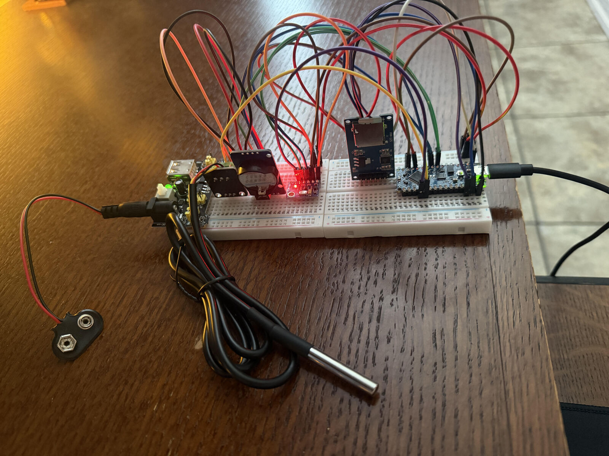

# Outdoor Environmental Monitoring Station

A battery-powered data logger built on an Arduino Nano Every. It reads barometric pressure, air temperature, and probe temperature, stamps each reading with a real-time clock, and writes the results to a CSV file on a MicroSD card every 2 seconds. It runs standalone, with no computer attached.



This project started as a high-altitude balloon payload. I scaled it down to a stationary outdoor station so I could finish and test it properly.

## Status

| Area | State |
|---|---|
| Sensor reading (pressure, temperature, probe) | Working |
| Real-time clock timestamps | Working |
| CSV logging to MicroSD | Working, verified standalone on wall power |
| Startup device checks and probe retry logic | Working |
| LED matrix display and rotary-encoder interface | Planned |
| Weatherproof enclosure for outdoor deployment | Planned |
| Python scripts to chart the logged data | Planned |

## Hardware

| Part | Role | Interface |
|---|---|---|
| Arduino Nano Every | Microcontroller | |
| GY-63 (MS5611) | Barometric pressure and temperature | I2C |
| DS18B20 waterproof probe | Soil, water, or outdoor air temperature | OneWire |
| DS3231 RTC module | Timestamps | I2C |
| MicroSD card module | CSV storage | SPI |
| MB102 breadboard power supply | 5V / 3.3V rails (prototype only) | |
| MAX7219 32x8 LED matrix (4-in-1) | Local readout (not yet installed) | SPI |
| KY-040 rotary encoder | Set logging interval (not yet installed) | GPIO |

### Wiring

| Signal | Pin |
|---|---|
| SD card chip select | D10 |
| DS18B20 data | D2 |
| I2C (MS5611 and DS3231) | A4 (SDA), A5 (SCL) |
| SPI (SD card) | D11 (MOSI), D12 (MISO), D13 (SCK) |


## Software

Built with the Arduino IDE 2.x for the **Arduino Nano Every** (install the *Arduino megaAVR Boards* package).

Libraries:
- SPI, SD, Wire (bundled with the IDE)
- RTClib
- MS5611 (by Rob Tillaart)
- OneWire
- DallasTemperature

To build: put `environmental_station.ino` in a folder called `environmental_station`, select the Nano Every board and port, then Verify and Upload.

## Output format

The logger writes `env_data.csv` to the SD card root:

```
Timestamp,Pressure_hPa,Baro_Temp_C,Probe_Temp_C
2026-10-28 12:24:18,1008.48,21.87,22.06
2026-10-28 12:24:20,1008.50,21.87,22.12
2026-10-28 12:24:22,1008.48,21.88,22.06
```

If the probe cannot be read, its field is left blank.

## How the code is organized

- `Reading` is a small struct holding one sample.
- `SensorReader` owns the clock, pressure sensor, and probe. `begin()` initializes them and `read()` returns a `Reading`.
- `CsvLogger` owns the SD card and the log file. It writes the header once and appends one row per reading.
- `loop()` uses a `millis()` timer instead of `delay()`, so the loop stays free for the display and encoder.

## Lessons and known issues

- **Intermittent first-reading failure.** The DS18B20 library returned `-127` (disconnected) on the first read after boot. I traced it to the one-time bus scan in `begin()`, and fixed it by rescanning the bus a few times at startup and retrying reads. Missing readings are logged as blank fields instead of bad values.
- **Standalone operation.** The original sketch waited forever for a USB serial connection, so it never started without a computer. It now waits at most 2 seconds.
- **Pressure scale factor (open question).** The pressure value from the MS5611 library is multiplied by 2.0 (`PRESSURE_SCALE` in the sketch). This is an empirical correction I still need to verify against a reference reading or the datasheet calculation. Readings look plausible (about 1008 to 1010 hPa), but I do not yet know why the factor is needed.
- **Compiler warnings.** The MS5611 library produces `requestFrom` overload warnings on the Nano Every. They come from the library code, not this sketch, and the logger works.

## Roadmap

1. Add the MAX7219 display and rotary encoder (set logging interval, show live readings).
2. Move from breadboard to soldered perfboard.
3. Weatherproof enclosure with a cable gland for the probe and a breather vent for the pressure sensor.
4. Multi-day outdoor run, with Python scripts to chart pressure and temperature.

## License

MIT License. See [LICENSE](LICENSE).

## Author

Cody Haeg
